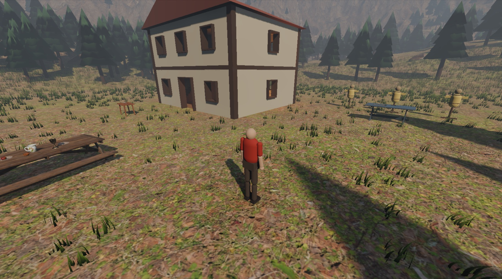

# Wormwood

A hobby open-world fantasy RPG prototype, built in [Godot 4.7](https://godotengine.org/)
as a way to learn game development. "Wormwood" is a working codename.

## What works so far

- Forested terrain with a clearing, a two-storey house you can walk through,
  and a day/night cycle.
- First- and third-person camera.
- Pick up and drop items: plates, goblets, apples, lanterns and more.
- Equip a sword or an axe and swing it. Chop down trees with the axe; knock
  the stuffing out of straw training dummies with either.

Planned: a village, NPCs, quests, an inventory and other RPG systems.

## Running it

1. Install [Godot 4.7](https://godotengine.org/download) (the standard
   version, not .NET).
2. Clone this repo, open Godot, choose **Import**, and select `project.godot`.
   The first open takes a minute while Godot imports the assets.
3. Press **F5** to play.

| Key | Action |
|---|---|
| WASD / arrows | Move |
| Mouse | Look |
| Space | Jump |
| E | Take, drop or equip what's under the crosshair |
| Left click | Swing the equipped weapon or tool |
| F | Toggle first / third person |
| Hold T | Fast-forward time |
| Esc | Quit |

## Project layout

- `main.tscn`: the game world.
- `player.gd`, `camera_rig.gd`, `mannequin.gd`: player movement, camera and
  procedurally animated body.
- `interactor.gd`, `combat.gd`, `item.gd`, `equipable.gd`: picking things up,
  equipping them and hitting things.
- `targets/`: things you can hit (trees, dummies).
- `props/`, `assets/`, `terrain/`: scenes, models and world data.
- `tools/`: scripts that generate the terrain, props and house. See the
  header comment in each for how to run it.

## Credits

- 3D models and textures from [Poly Haven](https://polyhaven.com/) (CC0).
- [EB Garamond](https://github.com/georgd/EB-Garamond) font, SIL Open Font
  License (see `assets/fonts/OFL.txt`).
- [Terrain3D](https://github.com/TokisanGames/Terrain3D) by Tokisan Games,
  MIT License (see `addons/terrain_3d/LICENSE.txt`).
